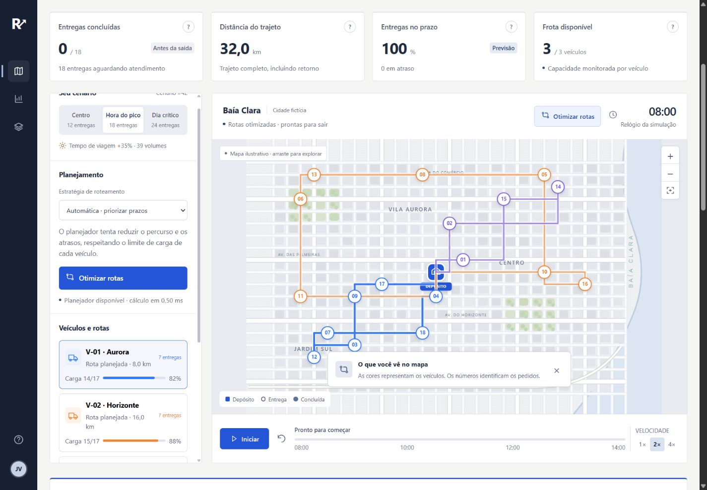
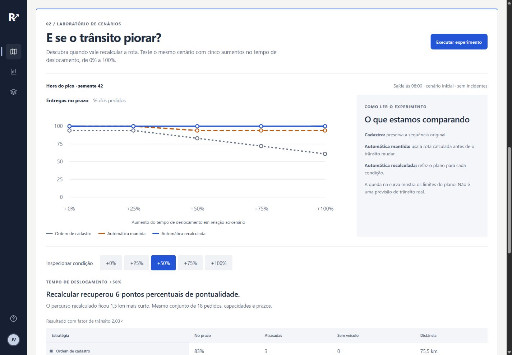

# RotaLab

**Simulação de entregas e análise de decisões de roteamento.**

Distribua pedidos entre veículos, compare planos e teste como eles respondem a trânsito mais lento. O motor C++ roda no navegador via WebAssembly; Python executa experimentos em lote.



## O problema

A menor distância nem sempre atende os prazos. O RotaLab torna esse conflito visível: cada plano respeita a capacidade da frota e é avaliado por distância, pontualidade e pedidos sem veículo. O usuário pode seguir a ordem de cadastro, escolher a sequência manualmente ou usar uma heurística de inserção e busca local.

## O diferencial: testar a resistência do plano

O laboratório mantém os pedidos constantes e aumenta o tempo de deslocamento em 0%, 25%, 50%, 75% e 100%. Compara a ordem de cadastro, a rota automática mantida e a rota recalculada. O gráfico, a tabela e o CSV mostram ganhos, empates e pioras.



## Rodar em um minuto

Requer **Node.js 22 ou superior**. Sem instalação de dependências.

```sh
node scripts/serve.mjs
```

Abra **http://127.0.0.1:4173**. O binário WASM está incluído. Use um servidor HTTP; abrir o HTML por `file://` não funciona.

1. Selecione **Hora do pico** e clique em **Comparar estratégias**.
2. Aplique as rotas automáticas e inicie a simulação. Pause ou provoque um incidente.
3. Execute o **Laboratório de cenários** e inspecione cada nível de trânsito.
4. Baixe o CSV ou copie o link do cenário inicial. O link registra cenário e semente, sem incluir incidentes.

A demonstração pública ainda será publicada. [Instruções de publicação](docs/PUBLISHING.md).

## Tecnologias e decisões

| Tecnologia | Uso |
| --- | --- |
| C++ | Heurística com capacidade, prazos e busca local |
| WebAssembly | Execução do motor no navegador, sem API remota |
| JavaScript / SVG | Simulação, mapa interativo, métricas e experimento |
| Python | Compilação e benchmark do motor nativo |
| GitHub Actions | Workflows preparados para testes e publicação estática |

O projeto explora otimização combinatória e análise de cenários. **Não utiliza um modelo treinado de machine learning.** [Arquitetura, função objetivo e escolhas técnicas](docs/ARCHITECTURE.md).

## Verificação

```sh
node --test
```

São 12 testes, incluindo viabilidade em 60 cenários, respeito à capacidade, veículos indisponíveis, determinismo, cálculo de distância e invariantes do laboratório. Os workflows também verificam a sintaxe dos módulos.

O [benchmark de 30 cenários sintéticos](experiments/RESULTADOS.md) registra média de 62,6 km para a referência e 28,3 km para a heurística. Essa comparação usa uma referência simples e não comprova ganhos em uma operação real. O gerador Python difere do gerador da interface.

## Estrutura

```text
dist/         aplicação estática e motor WASM pronto para executar
engine/       fonte C++ do motor
scripts/      servidor local, compilação, benchmark e pacote GitHub
tests/        testes do motor e do laboratório
experiments/  resultados reproduzíveis do benchmark
docs/         arquitetura, demonstração, imagens e publicação
.github/      validação e publicação manual no GitHub Pages
```

Para recompilar o motor, instale `ziglang==0.15.2` com pip e rode `python scripts/build_engine.py --zig /caminho/para/zig`. Isso gera o WASM e o executável nativo. O benchmark roda com `python scripts/benchmark.py --engine engine/optimizer.exe --scenarios 30` (no Linux/macOS, use `engine/optimizer`).

## Limites do modelo

- Cidade e dados sintéticos; distância Manhattan, 250 m por unidade e 26 km/h nominais.
- Trânsito uniforme; prazo medido no fim do atendimento; retorno ao depósito incluído.
- Heurística sem garantia de ótimo global ou melhoria em todas as métricas.
- Transbordo após quebra abstraído por oito minutos de apoio; sem rastreamento físico de carga.
- O laboratório parte sempre do cenário inicial às 08:00, sem incorporar incidentes do mapa.

[Roteiro de demonstração em dois minutos](docs/DEMO.md) · [Histórico de versões](CHANGELOG.md)

Projeto de [João Vitor Marinho](https://github.com/jvickz).
