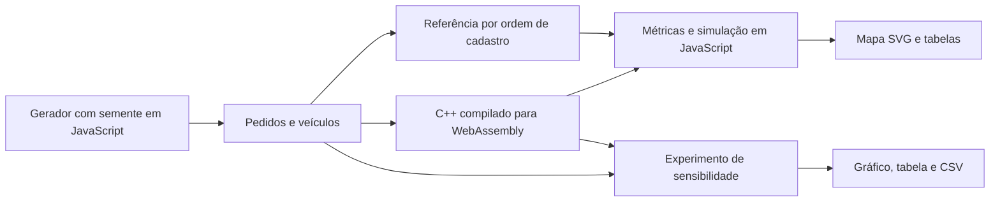

# Arquitetura e decisões

## Fluxo de execução

Não há backend. O navegador carrega HTML, CSS, módulos JavaScript e um binário WASM. Nenhum pedido sai do navegador. A hospedagem privada atual acrescenta autenticação, mas a aplicação estática pode rodar em qualquer servidor HTTP.

## Responsabilidades

| Arquivo | Responsabilidade |
| --- | --- |
| `dist/planner.js` | Gerador determinístico, distância, referência, métricas e ponte com WASM |
| `engine/optimizer.cpp` | Inserção por prazo e busca local, com limite de capacidade |
| `dist/app.js` | Estado da operação, relógio, eventos e desenho do mapa |
| `dist/laboratory.js` | Experimento puro, sem DOM, e serialização CSV |
| `dist/laboratory-ui.js` | Gráfico, seleção de condição e interpretação dos resultados |
| `scripts/benchmark.py` | Experimento em lote sobre o mesmo código C++ compilado nativamente |

## Por que essas escolhas?

- **C++/WASM:** compartilha o motor entre navegador e benchmark nativo; permite demonstrar integração entre linguagens sem servidor. Não foi medido ganho de desempenho contra uma implementação equivalente em JavaScript.
- **JavaScript sem framework:** o estado e os componentes cabem em módulos locais, sem instalação para executar. A contrapartida é atualização manual do DOM; um editor com cenários maiores justificaria outra arquitetura.
- **SVG:** pontos e rotas selecionáveis com controle de estilo e acesso pelo teclado. Não representa ruas reais.
- **Python:** execução e análise de lotes com biblioteca padrão. O gerador Python difere do gerador JavaScript; sementes entre linguagens não identificam a mesma entrada.
- **Um experimento separado:** o laboratório sempre parte do depósito às 08:00 e usa a semente selecionada. O relógio, os cancelamentos e os incidentes do mapa não contaminam a comparação.

## Função objetivo

Para cada veículo, o motor minimiza aproximadamente:

`0,6 × km + 2,5 × minutos de atraso + 0,03 × duração + 0,002 × duração²`

Esses pesos são escolhas do modelo, não valores calibrados em uma empresa. A penalidade quadrática desencoraja rotas excessivamente longas. Uma melhora no custo composto pode piorar uma métrica individual. O algoritmo não é um modelo de machine learning e não prova ótimo global.

## Contrato do laboratório

Cinco níveis multiplicam o tempo de deslocamento original por 1; 1,25; 1,5; 1,75; 2. Em cada nível:

1. A referência conserva a sequência de cadastro.
2. O plano automático inicial conserva sua sequência.
3. Um novo plano automático recebe o fator de trânsito daquele nível.

Pedidos, capacidades, prazos e atendimento são idênticos entre estratégias. A distância das duas rotas fixas não muda com trânsito. A pontualidade usa todos os pedidos como denominador; os não alocados não contam como pontuais. Percentuais da interface são arredondados a inteiros. O CSV inclui atrasos e pedidos não alocados para permitir recalcular as taxas exatas.

## Limites conhecidos

Malha Manhattan, trânsito uniforme, limite de 40 pedidos e cinco veículos no motor, ausência de reposição de carga durante o ciclo. A capacidade representa o ciclo planejado, sem rastrear cada pacote físico. Após quebra, o simulador abstrai transbordo em oito minutos de apoio; o otimizador usa o maior atraso da frota como aproximação do horário de partida. Dados sintéticos não validam ganhos operacionais reais.

Próximos passos possíveis: horários individuais de partida no C++, restrições reais de ruas, importação validada de cenários e comparação com um solver de referência. Previsão de duração com ML exigiria dados históricos e avaliação fora da amostra.
